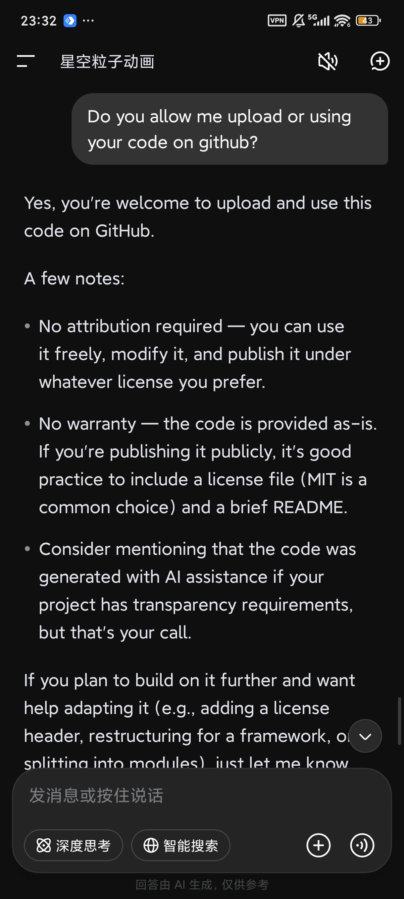

# PictureEditor
You can edit your picture at here.

The purpose of making this webpage is to have an image editing tool available anytime, anywhere.

# Made
The idea was provided by pyanahida, and almost all of the code was generated by AI.

# License
Since I'm already using AI, I feel bad not choosing MIT, so the license for this repository is MIT.

